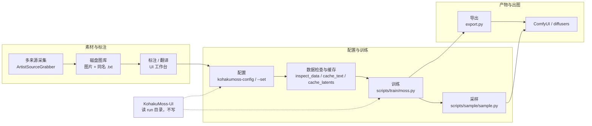

# 功能说明

**一句话**：MOSS-Image 的本地微调工作区——训练、采样与导出由一个训练器完成，Web 工作台架在它的命令行与文件契约之上，素材采集单独成一个服务。`KohakuMossTrainer`、`KohakuMoss-UI`、`ArtistSourceGrabber` 三者相互独立安装、独立运行，总仓只固定子模块提交指针。

本文只描述 1.0 发布范围内的能力，尽量给出可直接对照的代码路径与命令；未实现或未验证的部分集中写在「能力边界与已知限制」。

## 1. 总体数据流

数据从磁盘上的图片与 caption 开始，到适配器文件（或合并后的 transformer）结束，中间每一步都由独立脚本完成，可以单独重跑、单独检查。



三段式概括：

1. **素材段**：采集（可选）→ 磁盘图库 → 描述与标注。产出是「图片 + 同名 `.txt` 标签」这种训练器直接可读的数据布局。
2. **训练段**：写配置 → 检查数据规划 → 缓存文本/latent → 训练 → 采样。每一步都是 `kogine run <script>`，配置与 `--set` 覆盖是同一条路径。
3. **产出段**：导出适配器或合并 transformer → 在 ComfyUI 或 diffusers 中出图。导出的文件在 run 目录的 `export/` 下。

UI 位于整条链路的旁侧：它读 run 目录、调 CLI、管进程，但不写 run 目录，也不导入训练器源码。

## 2. KohakuMossTrainer（训练框架）

### 2.1 微调算法

`kohakumoss-config list` 的 `moss/algo` 分组只有六个预设（`KohakuMossTrainer/configs/moss/algo/`），配置里 `ALGO` 的合法值就是它们：

| `ALGO` | 层文件 | 说明 |
| --- | --- | --- |
| `lora` | `algo_lora.py` | LoRA / LoCon（LyCORIS 的 lora 模块），支持 `use_tucker`、`use_scalar`、`rank_dropout_scale` |
| `loha` | `algo_loha.py` | LoHa；`DORA = True` 时为 DoRA（LyCORIS `weight_decompose`） |
| `lokr` | `algo_lokr.py` | LoKr；`factor`（-1 为近方阵分解）、`full_matrix`、`decompose_both` |
| `oft` | `algo_oft.py` | OFT；`constraint`、`rescaled` |
| `dora` | `algo_dora.py` | LoRA + DoRA 的现成组合层 |
| `full` | `algo_full.py` | 全量微调：`ALGO="full"` 直接训练主干参数 |

算法实现来自 `lycoris-lora`，仓库只提供上表这些预设层；`DROPOUT` 是独立参数（映射到 LyCORIS 的 `dropout` / `rank_dropout` / `module_dropout`），`ALGO_KWARGS` 原样传给 LyCORIS 构造函数。全量微调走 `configs/moss/_base/base_full.py`：Muon + AdamW（5e-5）、weight decay 0.01、grad clip 1.0、EMA 0.9999。

### 2.2 精度

- 训练精度由 `moss/precision` 的两个层决定：`bf16` 与 `fp16`（fp16 配 `FP16_FIX = online`，`c = 1/16`）。采样脚本同样有 `bf16` / `fp16`。
- 冻结的基础权重另有 `BASE_PRECISION`：`auto`（保持 int8 基座）、`compute`（反量化后按 16 位算）、`int8`、`fp8`、`fp8_compute`、`mxfp8`。fp8 / MXFP8 计算需要 sm89+。
- 单文件权重与 HF 目录两种布局都支持：ComfyUI 布局（`diffusion_models/`、`text_encoders/`、`vae/`）与 HF pipeline 布局（`transformer/`、`text_encoder/`、`vae/`），由 `moss/weights` 的 `comfy` / `hf` 层选择。

### 2.3 显存配置档

`moss/vram` 分组的七个层，`kohakumoss-config new train` 会按显卡显存自动挑选：

| 层 | `MEMORY_PROFILE` | 每批词元 | 主要手段 |
| --- | --- | --- | --- |
| `24g` | `balanced` | 12288 | 块检查点 + 权重环形流式；文本编码器流式 |
| `16g` | `low` | 8192 | 4 个常驻块、激活卸载、主机 AdamW 状态 |
| `12g` | `ckpt-ring4-actoff-optstream-gradoff` | 6144 | 激活与梯度卸载、主机优化器状态、VAE 卸载 |
| `8g` | `minimal` | 4352 | 2 个常驻块、激活与梯度卸载、VAE 分块卸载 |
| `6g` | `ckpt-ring2-actoff-optcpu-gradoff` | 4352 | 同上，并要求 latent / 文本缓存离线 |
| `24g_full` | 全量微调的交换档 | 8192 | 主机 fp32 master + 权重流式，单卡 24 GB |
| `auto` | 估算可容纳的最快档 | — | 24 GB 以上显卡，由规划器挑选 |

显存档之外还有 `manual` 手动参数与 240 项 `MEMORY_PROFILE` 目录（`kohakumoss-config list --all`、`docs/concepts/profiles.md`）。小显存档会把 DiT 留在主机内存，主机 RAM 需求见 `docs/guides/configs.md#host-ram`。

### 2.4 支持的 GPU

按计算能力选择内核后端：sm70 / sm75 优先 TileLang，sm80 及以上与 Intel Arc 优先 Triton，之后是 `torch.compile`，eager 作为参考路径。代表性一行（完整表见 `KohakuMossTrainer/README.md` 的「支持的 GPU」）：

| 架构 | 首选内核 | 计算 dtype | fp8 / MXFP8 | 本版本状态 | 示例 |
| --- | --- | --- | --- | --- | --- |
| sm89 Ada | Triton | bf16、fp16 | fp8；fp16 MMA 上的 MXFP8 | 已测试 | RTX 4090、L4 |

sm120（RTX 5090 / RTX PRO 6000 Blackwell）同样标记为已测试；sm90、sm100 与 Intel Xe 标注为「支持，未测试」。Windows 上 sm75、sm86、sm89、sm120 与 Intel Arc 支持单卡全部功能，多卡仅 Linux。

### 2.5 并行方式与限制

`moss/parallel` 分组有四个层，对应 `PARALLEL` 的四个非 `none` 取值：

| `PARALLEL` | 引擎 | 适用 |
| --- | --- | --- |
| `ddp` | 分桶 SUM all-reduce（`GradReducer` / `AsyncReducer`），与 backward 重叠 | 所有内存档下的适配器训练；全量微调的权重流式 |
| `fsdp` | FSDP2 `fully_shard`（每个 conditioning linear、每个 block、再 root） | 单卡放不下的全量微调 |
| `pipeline` | `torch.distributed.pipelining` 按连续 block 分段 | 无高速互联，或模型单卡放不下 |
| `threaded` | 单进程、多设备分阶段 | 混合显卡（例如 3090 + 2080 Ti） |

限制写在参数校验里：**多 GPU 仅 Linux**——Windows 上 `PARALLEL` 只能是 `none`，`DEVICES` 只能有一项。`fsdp` / `pipeline` / `threaded` 会把内存档换成 `ckpt-resident` 并关闭训练中采样（`SAMPLE_EVERY = 0`）。

### 2.6 数据源与 caption 约定

`moss/data` 分组提供七种数据层，对应 `DATASETS` 条目里的 `source`：

| `source` | 结构 | caption 约定 |
| --- | --- | --- |
| `kohya` | `<重复数>_<名字>/` 子目录，图片与同名 `.txt` | 同名 `.txt` 即标签；根目录下的图片需 `"include_root": True` |
| `folder` | 任意目录树 + `.txt` / `.caption` / `.json` sidecar | `"txt_as": "tags"` 时按标签解析 |
| `folder_nl` | 同上 | 自然语言 caption |
| `jsonl` | 每行 `{"image": ..., "caption" / "text" / "caption_nl" / "tags": ...}` | 行内字段；`artist` / `rating` / `weight` / `group` 作为元数据 |
| `parquet` | `image_col` 列（或 `bytes_col` 内嵌图片）+ caption 列 | 同 jsonl 的字段名 |
| `webdataset` | `<key>.png` 与 `<key>.txt` / `<key>.json` 成员 | 同 key 的 sidecar |
| `moss_shard` | `catalog_build.py` 用 `import_to` 导出的分片目录 | 分片自带 `catalog.db` |

多个 `DATASETS` 条目按 `weight` 混合。captions 由 `CAPTION` 模板统一渲染，分辨率与分批由 `RESOLUTION_MODE`、`BATCHING`、`TARGET_AREA`、`MAX_TOKENS`、`ASPECT_RANGE` 控制；`scripts/data/inspect_data.py` 会先打印 catalog 与 epoch 0 的规划，再进入缓存与训练。

### 2.7 训练产物布局

每次运行写入 `runs/moss/<RUN_NAME>/`（`OUTPUT_DIR` 可改）：

```text
runs/moss/<RUN_NAME>/
  config.json                  # rank 0 启动时写入的配置快照
  log.txt                      # 同时输出到终端
  metrics.jsonl                # 每行一条 JSON 指标（step / loss / lr / ...）
  checkpoints/
    step_00001000/             # 先写 step_00001000.partial/，再整目录改名
      trainable.safetensors    # 适配器（或全量微调的参数）
      optim* / state / rng ... # 优化器、EMA、随机数状态等
      export/                  # CHECKPOINT_EXPORT=True（默认）时的导出
  samples/
    step_00001000/*.png        # 每个采样步骤一个目录
    grid.png                   # 所有采样步骤 × 提示词的总览图
  export/                      # 训练结束时的导出，SAVE_FORMAT 决定内容
```

- `checkpoints/step_XXXXXXXX/` 的目录名格式固定在 `kohakumoss/training/checkpoint/manager.py`（`STEP_DIR = "step_{:08d}"`），`.partial` 到正式目录的改名保证中断不会留下半个检查点。
- `samples/grid.png` 由采样回调生成（`kohakumoss/training/callbacks/evaluate.py`），行是采样步、列是提示词。
- `export/` 的内容由 `SAVE_FORMAT` 决定：`comfy`（默认，ComfyUI LyCORIS 文件）、`hf`（带 diffusers 模块名的 LyCORIS 文件）、`both`、`none`；`SAVE_MERGED` 追加合并后的 DiT。
- UI 侧读取的字段与目录名定义在 `KohakuMoss-UI/src/kohakumoss_ui/contract/runs.py`（`checkpoints/`、`samples/`、`export/`、`samples/grid.png`）。

### 2.8 配置与命令

```bash
kohakumoss-config list                                  # 分组与 recipe 清单
kohakumoss-config new train --weights ComfyUI/models --data path/to/dataset --name my-lora
kohakumoss-config new --from lora_24g_bf16 my_run.py     # 在固定 recipe 上扩展
kohakumoss-config wizard                                # 交互式生成
kohakumoss-config check configs/user/my-lora.py          # 走脚本的参数校验
kogine run scripts/train/moss.py --config configs/user/my-lora.py --set LR=2e-4 --set STEPS=2000
```

当前 checkout 的 `kohakumoss-config list` 输出 17 个 recipe：`dora`、`full_24g_offload`、`full_5090`、`full_ddp_4x5090`、`full_fsdp_4xv100`、`lokr_5090`、`lokr_ddp_4x5090`、`lora_12g_stream`、`lora_16g_fp16`、`lora_24g_bf16`、`lora_5090`、`lora_ddp`、`lora_ddp_4x5090`、`lora_xpu_b50`、`lycoris_loha`、`lycoris_lokr`、`lycoris_oft`。配置是 Python 文件，通过 `use_config("<层>")` 按层组合（`_base` → `weights` → `algo` → `data` → `vram` → `precision` → `parallel`），`--set` 的值按脚本里该参数的默认值做类型转换。

## 3. KohakuMoss-UI（本地工作台）

UI 是架在训练器命令行与文件契约之上的独立包：前端是静态 ES modules，后端是 `http.server` 实现的本地服务，默认绑定 `127.0.0.1`、自动挑端口并生成访问令牌。导航来自 `KohakuMoss-UI/src/kohakumoss_ui/web/index.html`，路由分派在 `web/app.js` 的 `renderRoute`。

| 页面 | 路由 | 读什么 | 写什么 |
| --- | --- | --- | --- |
| 训练记录 | `#/runs` | `runs/moss/*` 目录、`metrics.jsonl` 尾部、`log.txt` 尾部、托管 pid | 无 |
| 训练详情 | `#/run/<name>` | 单个 run 的 `config.json`、指标曲线、日志、检查点、样本、导出 | 无 |
| 新建训练 | `#/new` | AST 扫描训练脚本得到参数表；`configs/**/*.py` 清单 | 不写 run 目录；启动后由训练器创建，队列草稿存 UI state |
| 训练队列 | `#/queue` | 队列状态、托管进程是否存活 | UI state 的 `queue.json` |
| 数据集 | `#/datasets` | 配置里的 `DATASETS`、图片/caption 计数、`cache/` 是否存在 | 无 |
| 产物 | `#/artifacts` | 检查点、`export/`、样本缩略图、`samples/grid.png` | 无 |
| 环境体检 | `#/doctor` | `kohakumoss-doctor --json`（缓存 60 秒）+ 对用户配置的预检 | 无 |
| 设置 | `#/settings` | 主题家族、明/暗模式、外观（背景图 + 玻璃）、UI 缩放、密度、已发现路径 | UI state 的 `appearance.json` 与背景图 |
| 图片采集 | `#/grabber` | 受管采集服务的来源、进度、图库分组、凭据状态 | UI state 的采集凭据文件；不写图旁 `.txt` |
| 标注 / 翻译 | 挂在采集工作区内 | 标注快照、文档、计划、作业；翻译计划与词典 | 计划/译文只落 UI state；标签写入由 ASG 执行 |

### 3.1 训练记录


*截图为演示数据。*

扫描输出根下的每个 run 目录（默认 `<root>/runs/moss`），状态由三样东西拼出来：托管 pid 是否存活、`metrics.jsonl` 的最后一条指标、`config.json` 里的目标步数。没有托管记录时按「已到 `STEPS` → `done`、有指标但未完成 → `stopped`、只有 log/config → `unknown`、空目录 → `empty`」判定；有托管记录时只看 pid 存活，所以训练器正常结束但 pid 已退出的 run 可能显示 `stopped`，而队列里显示 `done`。

### 3.2 训练详情


*截图为演示数据。*

详情页读取 `config.json`（完整保存的配置）、`metrics.jsonl`（曲线，尾部读取后降采样到最多 800 点）、`log.txt`（尾部最多 400 行）、`checkpoints/step_*`（目录名后缀转步数、目录尺寸、内部 `export/` 文件名）、`samples/step_*/*`（文件名与字节数）与 `export/*`。日志增量接口按**字节偏移**推进，只返回换行完整的行。

### 3.3 新建训练


*截图为演示数据。*

参数表由 AST 扫描 `scripts/train/moss.py` 得到——当前 checkout 是 144 个模块级参数（README 里记的 143 是撰写时快照，上游仍在增加；数量以 `/api/knobs` 返回为准），后端不 import 脚本。改动只以 `--set KEY=VALUE` 的形式随命令下发，命令预览给出的就是实际执行的：

```text
<kogine> run scripts/train/moss.py --config <config_rel> [--set KEY=VALUE ...]
```

配置加载与检查在训练器解释器的子进程里完成（加载超时 60 秒，check 300 秒），UI 进程本身不 import 训练器。

### 3.4 训练队列


*截图为演示数据。*

队列是串行的 `waiting → starting → running → done/failed`，另有 `canceled`。暂停只停后续调度，不停正在跑的训练；`retry` 只对 failed/canceled 生效且不清训练目录；`clear-done` 只清已完成项。进程退出后按记录的步数判断 `done` 还是 `failed`，不看真实退出码。手动启动时如果队列已有活动项，队列会被标记为手动暂停。

### 3.5 数据集


*截图为演示数据。*

从 `user*`、`moss/data`、`moss/recipes`、`moss/_base` 配置的对象式 `DATASETS` 里收集条目，按 `(source, path)` 去重，统计每个目录的图片数、caption 数、文件数（每个目录最多 50,000 个文件，超出标 `truncated`）以及 `cache/` 目录是否存在。这个页面只扫描、不预处理，也不会替训练器建缓存。

### 3.6 产物


*截图为演示数据。*

把检查点、根导出、样本目录与 `samples/grid.png` 归到一个视图里，文件通过受 token 保护的 `/api/file` 路由按需读取，路径不能逃出该 run 目录。

### 3.7 环境体检


*截图为演示数据。*

主体是 `kohakumoss-doctor --json` 的结果（缓存 60 秒），另外附上一份预检：从用户配置里读权重与数据集路径，最多检查前 8 个 `user*` 配置，分别给出阻塞项与警告项。业务失败（doctor 报错、配置检查不通过）仍可能以 HTTP 200 返回，要看 `ok` / `error` 字段而不是状态码。

### 3.8 设置


*截图为演示数据。*

三套主题家族（Kohaku、Soul、Teletype），各有 light 与 carbon 两种模式；五个取色器（canvas、panel、text、border、accent）只作用于当前主题，空值表示沿用主题色。外观层与主题独立：自定义背景图（上传或 `https://` / `data:image/` URL，上传上限 25 MB）、图片模糊 0–30 px、遮罩比例，以及玻璃/透明度。UI 缩放范围 100–140 %，默认 110 %，密度可切。状态写到 UI state 目录的 `appearance.json` 与 `backgrounds/custom.*`，不读桌面壁纸、不取系统配色。Teletype 主题的完整规则见 `KohakuMoss-UI/docs/teletype.md`。

### 3.9 图片采集


*截图为演示数据。*

这一页是 UI 自己的采集工作台，直接对接受管的 ArtistSourceGrabber，不嵌入它的旧页面。包含来源与认证、任务配置（数量、页码范围、分级、仅图片）、实时进度、按下载分组浏览的磁盘图库与显式重新打标。服务需要显式点「启动服务」才会拉起（`POST /api/grabber/service/start`），不会自动登录、自动加载模型或自动下载。

### 3.10 标注 / 翻译工作台

没有独立导航项，入口在采集工作区的图库条目里。能力契约见 `KohakuMoss-UI/docs/annotation-workbench.md`（v1，状态为已实现），接口清单见 `KohakuMoss-UI/docs/interfaces.md`：

- 标注路由挂在 `/api/grabber/annotations/`（7 GET + 7 POST），先做 schema 校验，再读受管 ASG 的 `/api/sources` 并要求 `capabilities.annotations_v1 === true`，然后转发到 ASG 的 `/api/annotations/`。旧 ASG 缺该能力时返回 409 `UNSUPPORTED_CAPABILITY`，不会降级成旧的 `library` 语义。
- 流程是「冻结快照 → 编辑计划 → 服务端差异预览 → 确认后 apply（202 + job）→ 可撤销」，单个标注文件上限 65,536 字节，计划 TTL 1,800 秒；UI 只做校验与桥接，真正写图旁 `.txt` 的是 ASG。
- 翻译是 UI 本地能力（`/api/translation/`，7 GET + 9 POST）：本地词典 probe、分段、费用上限、作业都在 UI 侧；译文、计划、作业、请求日志、缓存、词典与凭据都放在 UI state 的 `annotations/` 下（目录 0700、文件 0600），不写图旁 sidecar，API key 只回 `hasKey` / `keyHint`。

### 3.11 UI 的边界

- **只通过 CLI / 文件 / 进程契约工作。** 唯一知道训练器名字（`kogine`、`metrics.jsonl`、参数名、run 布局、doctor JSON）的地方是 `KohakuMoss-UI/src/kohakumoss_ui/contract/`；其余代码只消费普通 JSON 模型。
- **不写 run 目录。** UI 自身状态全部在 `~/.local/state/kohakumoss-ui/`（可用 `--state` 或 `KOHAKUMOSS_UI_STATE` 覆盖），包括 `runs.json`、`queue.json`、`appearance.json`、`notebook.json` 等。
- **不导入训练器源码。** 启动是 `<kogine> run scripts/train/moss.py --config <config> [--set ...]`，cwd 为训练器根；只有「加载配置」这一步在训练器解释器的子进程里 import `kohakuengine`。
- **运行状态是推断出来的。** 托管 pid 存活 → `running`，否则 `stopped`；未托管的 run 按 `metrics.jsonl` 与 `STEPS` 推断。pid 记录不是可靠的进程身份令牌，pid 复用没有额外校验。
- **停止与续训。** POSIX 发 SIGTERM（训练器按 `SystemExit(143)` 收尾），`force` 用 SIGKILL；Windows 用 `taskkill /T`。没有「暂停」，续训只是启动时带上 `RESUME=latest` 覆盖。
- **SSE 不是事件日志。** `/api/events` 每秒发一次 `tick`，另有 `hello` 与队列快照 `queue`；没有 `id:` / `Last-Event-ID` 续传，断线期间的日志与队列变动不补发，重连后要重新 GET 快照。

## 4. ArtistSourceGrabber（素材采集）

一个以 Danbooru 画师实体为身份锚点的本地采集器，V2 版本线，独立仓库、独立 WebUI，UI 通过 HTTP 适配器把它当作受管子进程使用。

- **多来源。** 已注册来源共 8 个：`twitter`、`pixiv`、`danbooru`、`gelbooru`、`safebooru`、`konachan`、`yandere`、`openverse`。多来源任务接受 1–8 个来源，每个来源有自己的 `artist` / `query_type` / `rating` 配置，单个来源失败不影响其他来源。
- **搜索类型。** 画师 / 角色 / 通用标签；多标签按 AND 组合。查询能力与候选搜索能力分开暴露（`query_types` / `search_query_types`），X 与 Pixiv 只支持画师查询。
- **仅图片模式。** `images_only: true` 时强制关闭打标（`tagger_id: none`），不合并也不发送已保存的 AI 配置，不读取、不新建、不覆盖 `.txt`，已有 sidecar 原样保留；结果里 `caption_url` 为空、标签数组为空、`tag_status` 为 `skipped`。UI 提交前会检查受管 ASG 的 `capabilities.images_only === true`，旧服务缺能力时返回 409 并提示更新重启，不会静默降级。
- **可选 AI 打标。** 三种标签来源：站点原生标签、OpenAI-compatible 视觉 LLM、本地 WD14 ONNX（通用阈值与角色阈值分开，CUDA 可用时优先 GPU）；三种合并策略：仅打标器、来源 + 打标器、仅来源。
- **落盘与去重。** 默认保存为 `downloads/<画师名>/<来源>__<id>_<序号>.<ext>` 与同名 `.txt`；SHA-256 跨来源去重，重复图片合并标签而不是重复保存。可选把透明图先铺一层纯色底。
- **由 UI 拉起。** 默认根目录是训练器的兄弟目录 `ArtistSourceGrabber`，可用 `KOHAKUMOSS_GRABBER_ROOT` 覆盖（必须有 `app.py`）；解释器用 `KOHAKUMOSS_GRABBER_PYTHON` 指定，否则优先采集器自己的 `.venv/bin/python`。启动命令是 `<selected-python> <grabber-root>/app.py --no-browser`，ASG 在 `127.0.0.1:8710..8719` 中自行选端口，适配器从它的 stdout 公告里取真实端口并探测 ready。依赖必须事先装好；`available` 只表示 `app.py` 存在，不代表依赖就绪。

## 5. 能力边界与已知限制

- **Windows 未完整测试。** 1.0 完成了启动脚本、进程探测、编码、文件语义与工具链发现的兼容性修复，但没有在真实 Windows 设备上跑通完整训练、多卡与采集流程；采集后端的浏览器进程管理与安全文件读取仍含 POSIX 假设（`openat` / `O_NOFOLLOW` / `pread`）。
- **多 GPU 仅 Linux。** DDP、FSDP2、pipeline、threaded 四种方式都要求 Linux；Windows 上参数校验会直接拒绝。
- **`KohakuGBC` 尚未实现。** 图结构图像描述不在 1.0 发布范围，组件表、安装与快速开始都没有它。
- **关闭 UI 不等于停止采集。** UI 进程退出时会停止自己启动的训练进程（5 秒窗口），但会保留 ASG 子进程与正在进行的任务；重启 UI 不会接管旧服务，也拿不到旧任务历史，需要先记录原服务的端口/PID。
- **UI 不提供训练暂停、不创建配置、不带桌面二进制。** 暂停训练器本身没有；配置用 `kohakumoss-config new` 或 `wizard`；桌面壳目前是浏览器或 pywebview。
- **没有发布 API。** `POST /api/publish` 是固定 405 的拒绝分支，Civitai 相关只有只读查询。
- **数据合规由使用者负责。** 采集器只处理用户显式提交的任务，源站的访问许可、作品版权、许可证与当地法律需要自行核验。

## 6. 与上游的关系

| 本仓库组件 | 上游 | 关系 |
| --- | --- | --- |
| `KohakuMossTrainer` | [KohakuBlueleaf/KohakuMossTrainer](https://github.com/KohakuBlueleaf/KohakuMossTrainer) | 分支；保留上游的算法、配置层、内核与文档结构，版本号 1.0.0 |
| `KohakuMoss-UI` | 本仓库维护的独立包（MIT） | 架在训练器 CLI 与文件契约之上，没有对应的上游项目 |
| `ArtistSourceGrabber` | [salmantais961-boop/ArtistSourceGrabber](https://github.com/salmantais961-boop/ArtistSourceGrabber) | 分支；沿用其 2.x 版本线，合并了 Linux 兼容与角色/标签搜索的贡献 |
| `KohakuGBC` | — | 尚未实现，不在 1.0 内 |

总仓只固定子模块的提交指针，不合并源码、不提供统一安装器，也不接管各子项目的依赖、测试与发布节奏。Trainer 的功能类 PR 需要先有已批准的 issue（见 `KohakuMossTrainer/CONTRIBUTING.md`）。

## 7. 相关文档

- 训练器：[README](../KohakuMossTrainer/README.md)、[中文文档索引](../KohakuMossTrainer/docs/zh-CN/README.md)；安装、数据、配置、全量微调、多卡、导出与推理分别在 `docs/guides/` 下。
- UI：[README](../KohakuMoss-UI/README.md)、[接口参考](../KohakuMoss-UI/docs/interfaces.md)、[采集接入](../KohakuMoss-UI/docs/grabber.md)、[标注工作台契约](../KohakuMoss-UI/docs/annotation-workbench.md)、[Teletype 规范](../KohakuMoss-UI/docs/teletype.md)。
- 采集器：[README](../ArtistSourceGrabber/README.md)、[接口参考](../ArtistSourceGrabber/docs/API.md)。
- 变更记录：[CHANGELOG](../CHANGELOG.md)。
