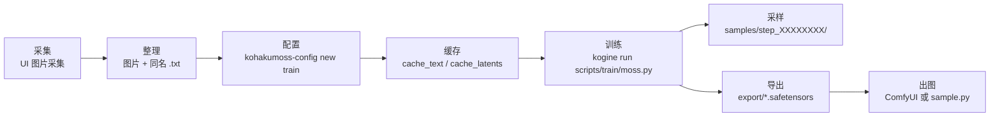
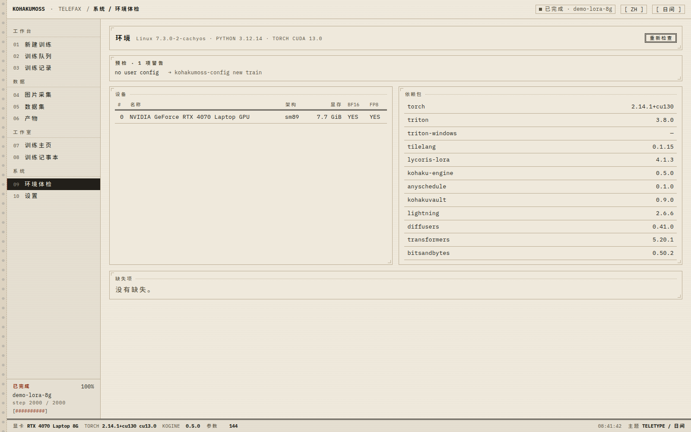
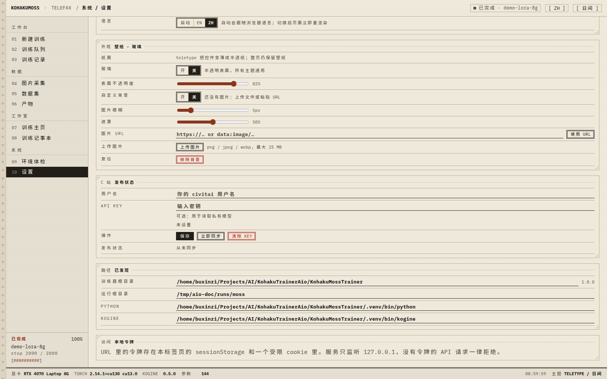
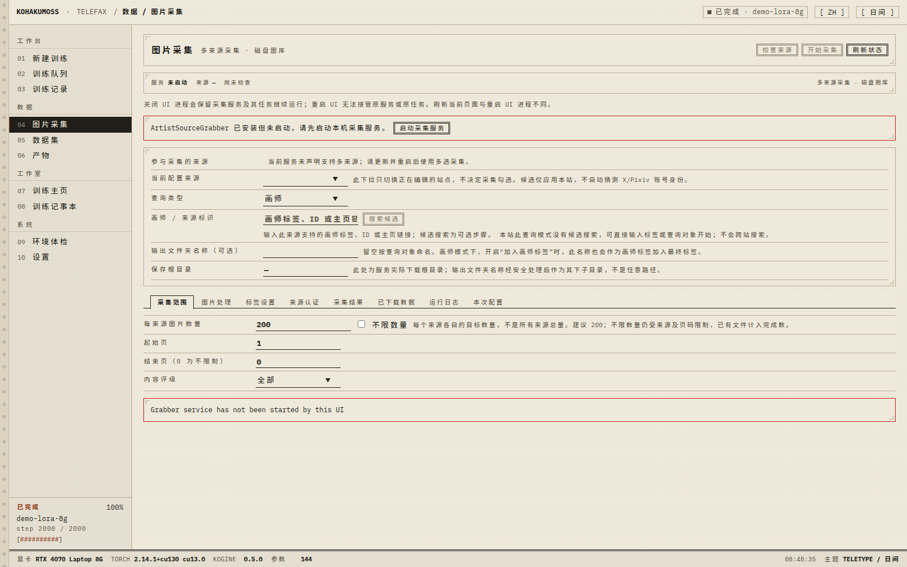
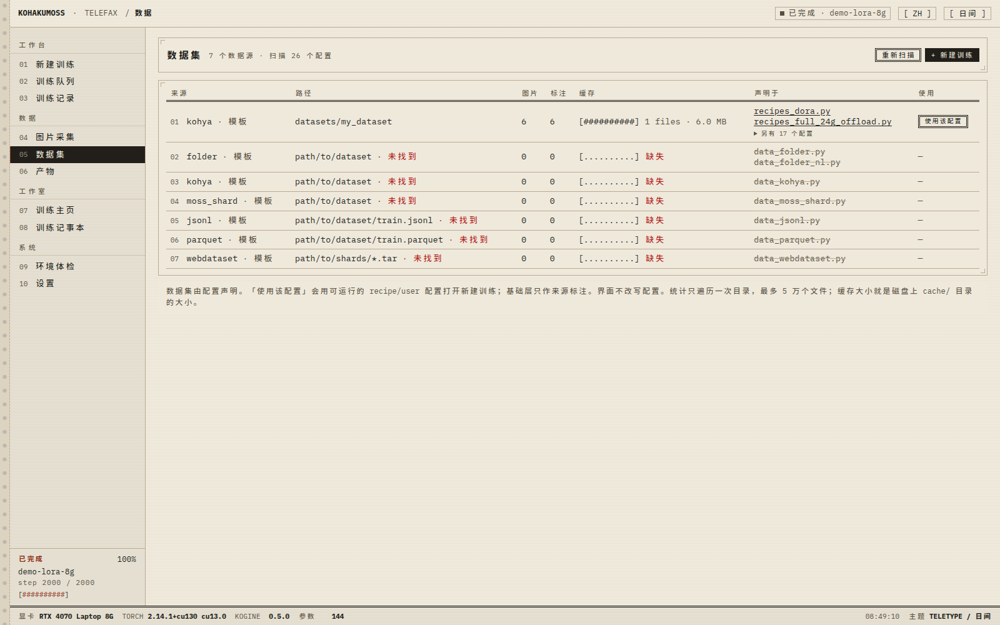
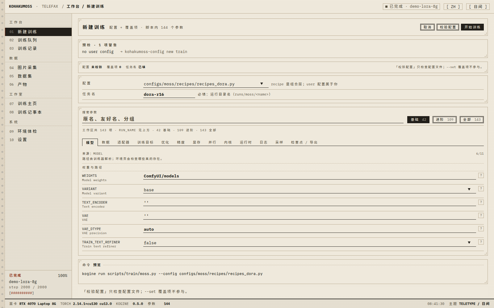
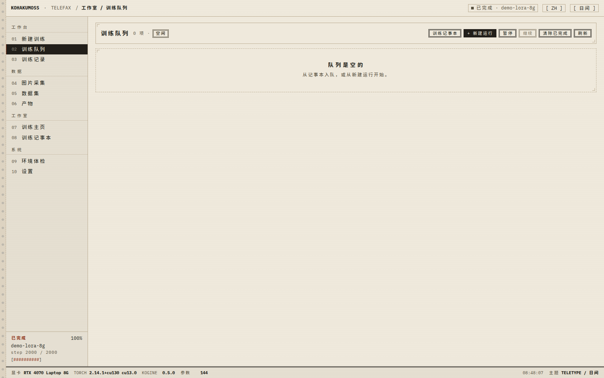
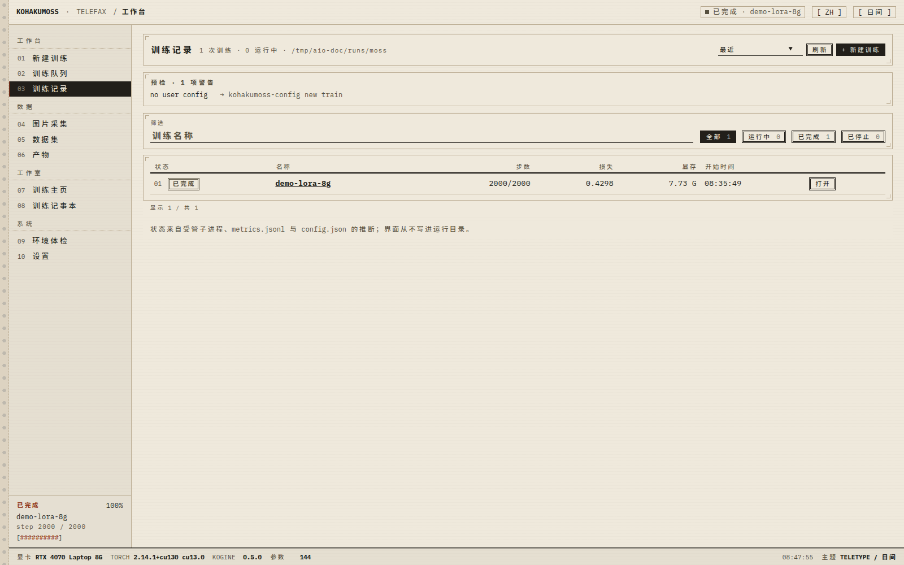
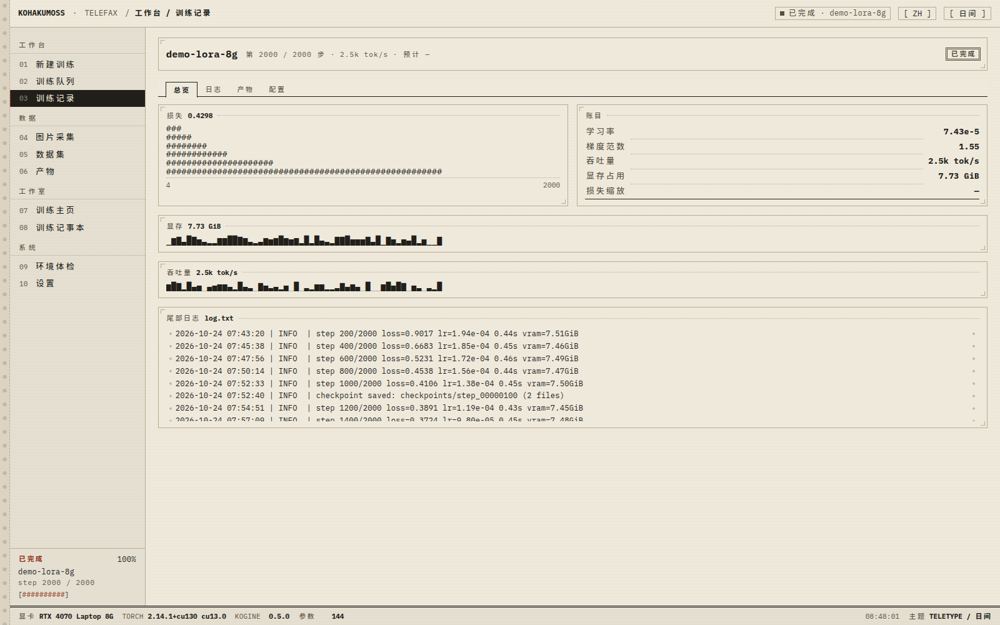
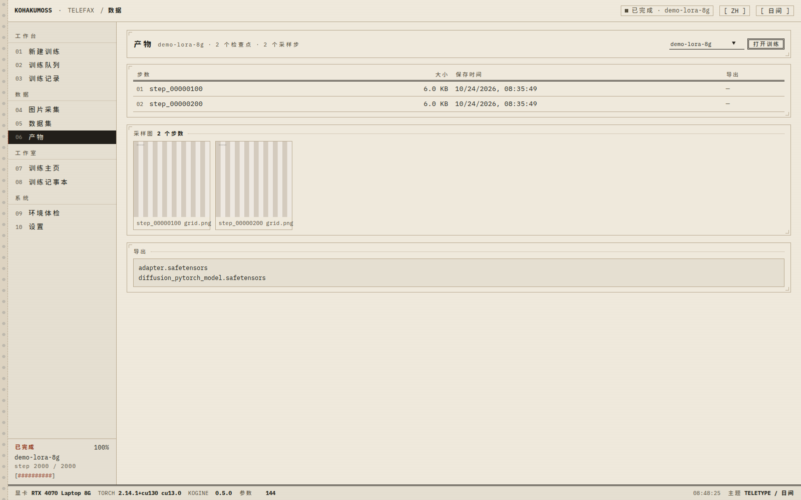

# MOSS-Image 训练图文教程（1.0）

面向第一次上手的人：从装环境、收素材，到训练出一个能进 ComfyUI 的 LoRA。命令取自
`KohakuMossTrainer` 的指南文档，未改写；出处见文末「命令出处」。

## 0. 开始之前
**做什么 / 为什么**：先确认显存落在哪一档——它决定每步词元预算、是否卸载文本编码器与 VAE。选错会在
第 0 步被拒绝或直接 OOM。`kohakumoss-config new train` 按本机显存组合出的 VRAM 层（Trainer README）：

| 层 | 显存 | 配置档 | 每批词元 | 编码器 |
| --- | --- | --- | --- | --- |
| `vram_24g` | 24 GB | `balanced` | 12288 | 文本编码器流式 |
| `vram_16g` | 16 GB | `low` | 8192 | 文本编码器流式 |
| `vram_12g` | 12 GB | `ckpt-ring4-actoff-optstream-gradoff` | 6144 | 文本编码器流式，VAE 卸载 |
| `vram_8g` | 8 GB | `minimal` | 4352 | 文本编码器流式，VAE 卸载并分块 |
| `vram_6g` | 6 GB | `ckpt-ring2-actoff-optcpu-gradoff` | 4352 | 必须两种离线缓存 |

- 8 GB / 6 GB 把 DiT 留在主机内存：步骤期约 19 GiB 主机 RAM，构建期约 32 GiB（含 15.63 GiB 文本编码器）。
- 支持架构见 README 表格：sm70 / sm75 / sm80 / sm86 / sm89 / sm120 已测试，sm90 / sm100、Intel Xe 为
  「支持，未测试」；多 GPU（DDP / FSDP2 / 流水线 / 线程化）仅限 Linux。
- **磁盘**：ComfyUI 布局约 15 GB，HF bf16 约 26 GB；检查点各带 `export/`，`KEEP_LAST` 默认 3。
- **时间**：README 实测 LoRA r32、`balanced`、RTX 4090：无缓存 0.49 张/秒，两种缓存 0.73 张/秒；首次
  运行另有内核预热开销。当参考量级，不当承诺值。
- **Windows**：1.0 的 Windows 支持**未完整测试**，只做了工具链探测、编码、进程与文件语义修复。

## 1. 安装
**做什么 / 为什么**：官方助手按驱动 CUDA 版本装 torch 与 KohakuMoss，再体检。没激活虚拟环境就跑命令，
是最常见的「找不到 `kogine`」。

Linux（在 `KohakuMossTrainer/` 内）：
```bash
bash scripts/install/install.sh
source .venv/bin/activate
kohakumoss-doctor
```
Windows：
```bat
powershell -ExecutionPolicy Bypass -File scripts\install\install.ps1
.venv\Scripts\activate.bat
kohakumoss-doctor
```
PowerShell 激活用 `.venv\Scripts\Activate.ps1`，需先执行一次 `Set-ExecutionPolicy -Scope CurrentUser RemoteSigned`。



<sub>截图为演示数据，路径/数值以你本机为准</sub>

**怎么确认成功**：doctor 打印系统、Python、torch 构建、每张卡的架构、各后端冒烟构建（如
`status triton@cuda:0 ok`）与 `missing:` 段；`missing:` 为空且架构认对才算装好，缺什么它给修复命令。

再装本地工作台（用 Trainer 的虚拟环境，UI 才看得到 `kogine`），在仓库根目录：
```bash
cd KohakuMoss-UI
uv pip install -e .
cd ..
./start.sh
```
**UI 对应**：`./start.sh` 前台启动，默认只监听 `127.0.0.1`、自动选空闲端口并打印带 token 的 URL，
`Ctrl+C` 停止。设置页列出它发现的路径，用来核对有没有指到正确的 Trainer。



<sub>截图为演示数据，路径/数值以你本机为准</sub>

## 2. 准备权重
**做什么 / 为什么**：1.0 的配置默认用 ComfyUI 布局（一个组件一个文件），训练直接用 int8 DiT 与 int8
文本编码器，不必先反量化。`WEIGHTS` 指到下载目录：
```bash
hf download Comfy-Org/MOSS-Image diffusion_models/moss_image_base_int8_convrot.safetensors \
    text_encoders/qwen3.5_9b_int8_convrot.safetensors vae/flux2-vae_small.safetensors \
    --local-dir ComfyUI/models
```
```text
ComfyUI/models/
  diffusion_models/  moss_image_base_int8_convrot.safetensors   (5.4 GB)
  text_encoders/     qwen3.5_9b_int8_convrot.safetensors        (9.7 GB)
  vae/               flux2-vae_small.safetensors                (0.25 GB)
```
- 文件名不必手填：`TRANSFORMER` / `TEXT_ENCODER` / `VAE` 留空时按默认顺序取第一个存在的文件（int8 优先）。
- HF 布局同样可用：`hf download OpenMOSS-Team/MOSS-Image-Base --local-dir models/MOSS-Image-Base`（约 26 GB
  bf16），`WEIGHTS` 指到该目录；SFT 底模下 `diffusion_models/moss_image_sft_int8_convrot.safetensors` 并加
  `--set VARIANT=sft`。
- **怎么确认成功**：三个文件都在对应子目录；缺文件时报 knob 错误并列出所有尝试过的路径（UI 无对应页，权重只认目录）。

## 3. 准备数据
**3.1 自己整理 kohya 目录**——图片 + 同名 `.txt`，子目录名前缀数字是重复次数：
```text
dataset/
  5_some_artist/      image files + same-stem .txt tag files
  1_another/
```
图片直接放 `dataset/` 根下时，要在 `DATASETS` 条目里加 `"include_root": True`，或改用 `--source folder`；
否则扫描找不到图会报错并说明布局要求。

**3.2 用采集器收素材**——素材不在本地时，用 UI 的图片采集工作台按来源抓取，并顺手打出同名 `.txt`。
采集器由 UI 作为独立服务拉起，不会自动登录或下载。

**UI 对应**：图片采集页 → 先点「启动采集服务」→ 勾选来源 → 选「查询类型」（画师 / 角色 / 通用标签；
角色与标签模式下 X、Pixiv 自动禁用）→ 填「每来源图片数量」→ 确认「保存根目录」→ 开始抓取。实时进度
在「采集结果」，落盘结果在「已下载数据」。



<sub>截图为演示数据，路径/数值以你本机为准</sub>

- 输出是 `downloads/<画师名>/<来源前缀>_<id>.jpg` 加同名 `.txt`；跨来源 SHA-256 去重并合并标签。
- 关掉 UI **不会**停掉采集服务，也不恢复任务历史；重启前先记下状态的 `pid` / `port`。
- 首次抓 X / Pixiv 要在专用 Chrome 窗口自行登录；Web 服务只监听 `127.0.0.1`，别改公网。
- 素材的站点条款、授权与法律合规要自己确认，工具不替你取得这些权利。

**3.3 caption 约定与踩坑**：

- **同名**：`a.png` 配 `a.txt`，扩展名与大小写都要对上。
- **编码**：读取先 `utf-8-sig`（自动丢 BOM），失败回退系统 locale 且 `errors="replace"`——**GBK 文件在
  非中文 locale 下会变成乱码且不报错**，统一存 UTF-8。
- **分隔符**：只认半角 `,`；中文逗号 `，` 不切分，整行会变成一个超长 tag。
- **顺序**：tag 顺序影响 `CAPTION` 模板与 `TEXT_DROP`（按位置/分组丢 tag），同一套数据保持固定顺序。

## 4. 检查数据集
**做什么 / 为什么**：先在 UI 看「有没有声明、图与标注是否配对、缓存建了没有」，再用 Trainer 脚本看
规划器怎么排 batch。数据集页的「图片」「标注」是磁盘实际计数，「缓存」是 `<数据集>/cache/` 的存在与
大小，「声明于」是哪些配置声明了它（基础层标为模板）；统计最多 5 万个文件，界面不改写配置。



<sub>截图为演示数据，路径/数值以你本机为准</sub>
```bash
kogine run scripts/data/inspect_data.py --config configs/user/my-lora_data.py
```
输出：目录清单（行数、epoch 大小、尺寸/宽高比分位、alpha 占比）、epoch 0 规划（每批样本与词元、预算
填充、裁切损失、放大比例、常见尺寸、超长样本丢弃）与 caption 样例。

**怎么确认成功**：行数 ≈ 图片数、每张图 caption 非空、丢弃数可接受。要改 `RESOLUTION_MODE` /
`TARGET_AREA` / `MAX_TOKENS` / `OVERLONG`，**必须在建缓存之前**——目标尺寸是 latent 缓存键的一部分。

## 5. 选配置
**做什么 / 为什么**：不要手抄整份配置，先看预设，再让工具按本机 GPU 与数据集生成：
```bash
kohakumoss-config list
kohakumoss-config new train --weights ComfyUI/models --data <dataset> --name my-lora
kohakumoss-config check configs/user/my-lora.py
```
`list` 打印 recipes、各层（weights / algo / data / vram / precision / parallel）与显存档；`new train` 写出
`configs/user/my-lora.py` 与 `configs/user/my-lora_data.py`；不想记参数就用 `kohakumoss-config wizard`，
改固定配方用 `kohakumoss-config new --from lora_24g_bf16 my_run.py`。要动的 knob（默认值来自
`scripts/train/moss.py`）：

| knob | 默认 | 说明 |
| --- | --- | --- |
| `ALGO` | `lora` | `lora` / `locon` / `loha` / `lokr` / `oft` / `boft` / `glora` / `ia3` / `dylora` / `tlora` / `full` |
| `DIM` | 32 | 秩；LoKr 还看 `ALGO_KWARGS["factor"]` |
| `LR` | `1e-4` | 命令行覆盖写 `--set LR=2e-4` |
| `STEPS` | 1000 | 优化步数（不是图片数） |
| `PRECISION` | `bf16` | 无 bf16 的卡用 `fp16`（层自动加 `FP16_FIX="online"`） |
| `MEMORY_PROFILE` | `balanced` | 显存档，一般交给 `--vram` 自动选 |
| `DATASETS` | 占位 | 一个数据源一个条目，多条目按 `weight` 混合 |
| `BATCH_SIZE` | 4 | `BATCHING="count"` 时每批样本数 |
| `RESOLUTION_MODE` / `TARGET_AREA` | `resize` / 1024² | 原生宽高比，面积约 1 MP |
| `MAX_TOKENS` | 16384 | 每批联合词元预算，显存档会覆盖 |

显存档怎么挑：6 / 8 / 12 / 16 / 24 GiB 选同尺寸那层（`--vram 8` 可强制），超过 24 GiB 用 `auto`；低于
6 GiB 会被拒绝，消息点名 `--vram` 与 `--vram-tolerance`。

**UI 对应**：新建训练页是「配置 + 覆盖项 + 命令预览 + 校验配置」四件套：选配置，只在覆盖项里改要改的
knob，命令预览显示 `kogine run scripts/train/moss.py --config <配置> --set KEY=VALUE...`，校验配置调的
是 `kohakumoss-config check`。注意它只检查配置文件，**`--set` 覆盖项不参与**，覆盖项写错要到启动时
才暴露；`RUN_NAME` 决定输出目录与导出名，Windows 上不能含非法字符、保留设备名或结尾的点/空格。



<sub>截图为演示数据，路径/数值以你本机为准</sub>

## 6. 缓存文本嵌入与潜变量
**做什么 / 为什么**：离线缓存是一次性开销，换掉每步在线跑 VAE 与 15.63 GiB 文本编码器的成本；6 GB 层
**必须**先建好两种缓存。
```bash
kogine run scripts/data/cache_text.py --config configs/user/my-lora_data.py
kogine run scripts/data/cache_latents.py --config configs/user/my-lora_data.py
```
- 默认 `LATENT_CACHE = "offline"`、`TEXT_CACHE = "offline"`，缓存在第一个数据集路径下的 `cache/`；两遍
  都跳过已存在的键，中断后重跑接着做。
- 改了目标尺寸、裁切/翻转、caption 模板、变体或种子，缓存键就变，必须重跑；离线 miss 报错会列出不一致
  的键并打印重建命令。latent 键含文件指纹（大小、mtime、绝对路径），同一批图换挂载路径（`D:/data` ↔
  `/mnt/data`）会全部 miss，按挂载路径各建一次。
- **怎么确认成功**：数据集页「缓存」不再是「缺失」，两个脚本跑完没有 miss 行。

## 7. 启动训练
**做什么 / 为什么**：先小步数跑通，再放开步数。首次运行会在第 0 步前做内核预热并记录决策，之后同卡
同形状复用。**UI 路径**：新建训练 → 选配置、改覆盖项 → 校验配置通过 → 「开始训练」。进程以独立进程
组启动，命令就是 `kogine run <配置>` 加你编辑过的 `--set`；停止是 SIGTERM（没有暂停），任务进入训练
队列排队。



<sub>截图为演示数据，路径/数值以你本机为准</sub>

**CLI 路径**：
```bash
kogine run scripts/train/moss.py --config configs/user/my-lora.py
```
- 命令行覆盖任何 knob：`--set LR=2e-4 --set DIM=16`，或 `--set LR=2e-4 --set STEPS=2000`。
- 断点续训：`--set RESUME=latest`（也可直接写某个检查点目录）；关训练期采样：`--set SAMPLE_EVERY=0`。
- 多卡（仅 Linux）：给 `new train` 加 `--gpus 2`，再跑同一条命令，脚本自己起进程。确认成功：
  日志出现 `training from step 0 to <STEPS>`，进度条后置字段开始更新，`runs/moss/<RUN_NAME>/` 下出现
  `config.json`、`log.txt`、`metrics.jsonl`。

## 8. 看训练进展
**做什么 / 为什么**：只看 loss 会误判。进度条一次给六个量：EMA 平滑 loss、lr、grad_norm、s/it、
samples/s、tokens/s，以及 `vram`（本步峰值分配 / 峰值保留 / 设备占用，GiB）。



<sub>截图为演示数据，路径/数值以你本机为准</sub>



<sub>截图为演示数据，路径/数值以你本机为准</sub>

详情页把同样的量拆成「损失 / 学习率 / 梯度范数 / 吞吐量 / 显存占用 / 损失缩放」并给日志尾；数据源是 `metrics.jsonl`，日志尾来自 `log.txt`，所以 CLI 跑完再看 UI 也一致。

- **正常收敛**：loss 前几十步快速下降后缓慢下降并有抖动，grad_norm 在个位到几十，lr 按 cosine
  （`SCHEDULE` 默认 `warmup: 100`）先升后降，s/it 稳定。
- **不收敛 / 爆炸**：loss 长时间横盘且采样图无变化（多为 LR 过大、caption 与目标风格不匹配、步数
  太少）；loss 突然冲高、grad_norm 出现 3 位以上或 `nan`，先停，降 `LR` 或开梯度裁剪，fp16 卡确认
  `FP16_FIX` 生效。
- **日志细节**：非续训跑进已有目录时，旧 `metrics.jsonl` / `log.txt` 改名成 `metrics.<n>.jsonl` /
  `log.<n>.txt`（各一条 WARNING）；续训则追加，并把该步之后的多余行挪走，一个文件里一步一行。

## 9. 采样与中间检查点
**做什么 / 为什么**：训练期采样是判断「学到没有」最可靠的信号；检查点自带导出，可随时拿中间结果出图。
```text
runs/moss/<RUN_NAME>/
  samples/step_00000500/        训练期采样图（按 SAMPLE_EVERY）
  samples/grid.png              所有采样步 × 所有提示词的对比网格
  checkpoints/step_00000500/    trainable.safetensors、state.json、optim、export/
  checkpoints/step_00001000/    …
  export/<RUN_NAME>-comfy.safetensors
  export/<RUN_NAME>-lycoris.safetensors
```
`KEEP_LAST`（默认 3）连检查点一起删更早的目录；`CHECKPOINT_EXPORT=True`（默认）让每个检查点都带 `export/`，代价是磁盘成倍占用；`SAMPLE_EVERY=0` 关闭训练期采样。**UI 对应**：产物页汇总检查点、导出文件、采样缩略图与 `grid.png`。



<sub>截图为演示数据，路径/数值以你本机为准</sub>

## 10. 导出与出图
**做什么 / 为什么**：训练结束按 `SAVE_FORMAT` 自动导出（基础配置 `both`：ComfyUI + LyCORIS）；中途停下
的跑法用 `export.py` 从任意检查点补导出。
```bash
# ComfyUI 适配器（WEIGHTS 可以是 ComfyUI 目录或 HF 目录）
kogine run scripts/export/export.py --set WEIGHTS=ComfyUI/models \
    --set ADAPTER=runs/moss/<RUN_NAME>/checkpoints/step_00001000/trainable.safetensors \
    --set OUT=moss_lora.safetensors
kogine run scripts/export/export.py --set FORMAT=merged ...     # 合并后的 transformer
kogine run scripts/export/export.py --set FORMAT=hf ...         # LyCORIS 文件
kogine run scripts/export/export.py --set FORMAT=diffusers ...  # diffusers transformer 目录
kogine run scripts/export/merge.py --config <file with WEIGHTS / ADAPTERS / OUT>
```
- `FORMAT` 合法值：`comfy`、`hf`（= `lycoris`）、`lycoris`、`merged`、`diffusers`。`SAVE_FUSED_QKV` /
  `FUSED_QKV` 的 `auto` 跟随训练所用 DiT 的 q/k/v 布局（Comfy-Org 文件融合，HF transformer 目录不融合）；
  布局写错，ComfyUI 里加载不上。int8 底模的合并文件是「反量化底模 + bf16 的 dW」，不是 fp32。

先写采样配置，再出图：
```bash
kohakumoss-config new sample --weights ComfyUI/models --adapter runs/moss/my-lora/export/my-lora-comfy.safetensors --name my-lora-sample
kogine run scripts/sample/sample.py --config configs/user/my-lora-sample.py --set PROMPT="a lighthouse on a rocky coast at sunset"
```
或全用命令行（`ADAPTERS` 是 `文件:强度`）：
```bash
kogine run scripts/sample/sample.py --set WEIGHTS=ComfyUI/models \
    --set PROMPT="a cat" --set ADAPTERS=my_lora.safetensors:0.8 --set OUT=out/samples
```
ComfyUI 侧用其 MOSS-Image 加载器 + 普通 LoRA loader 节点，默认合并模式加载 `comfy` 文件。采样显存比
训练低；紧的时候用 `new sample` 生成的配置（沿用该卡训练档的 `MEMORY_PROFILE`）；导出结果在产物页可见。

## 11. Windows 差异
- 虚拟环境在 `.venv\Scripts\`（`kogine.exe`、`kohakumoss-doctor.exe` 都在这），不是 `.venv/bin/`；`cmd` 用
  `.venv\Scripts\activate.bat`，PowerShell 用 `.venv\Scripts\Activate.ps1`。
- 训练、缓存、导出、采样命令与 Linux 相同；启动 UI 用 `start.bat`（原生 cmd），也可
  `python -m kohakumoss_ui --root <Trainer>`。
- 多 GPU 仅限 Linux，Windows 上 knob 校验会直接拒绝；UI 停止训练在 Windows 走 `taskkill /T`，POSIX 才有
  优雅 SIGTERM 语义。
- **再次强调：Windows 路径未完整测试**，采集后端仍含 POSIX 假设（`openat` / `O_NOFOLLOW` / `pread`、
  浏览器进程管理）。报问题时附系统、GPU、CUDA 版本与日志。

## 12. 常见问题
**显存不足（OOM）**：第 0 步或采样 OOM。原因：显存档大于实际可用显存，或 `MAX_TOKENS` / `BATCH_SIZE`
超预算。处理：换小一档（`--vram 8` / `--vram 6`）、降 `MAX_TOKENS`、降 `TARGET_AREA`（如 `802816`）；
6 GB 层必须先建两种离线缓存。

**OOM 但显存没满**：torch 报 OOM，`nvidia-smi` 仍有余量。原因：小显存档把 DiT、文本编码器、AdamW 状态
放在主机内存（pinned），是主机 RAM 不够；Windows 上 `nvidia-smi` 报的是相对空闲基线的占用，口径也不同。
处理：看 `log.txt` 的显存计划，按 README 留足主机 RAM，关掉其它吃内存的程序。

**loss 不降 / 出现 NaN**：loss 横盘或直接 `nan`。原因：LR 过大、fp16 数值问题、坏样本（空 caption、
全黑图）。处理：降 `LR`，fp16 卡确认 `FP16_FIX="online"`，开 `GRAD_CLIP`，检查非有限值告警；把
`SAMPLE_EVERY` 设小一点，看采样图是否真的在变。

**训练很慢**：s/it 远高于预期。原因：首次运行的内核预热与 `RETUNE_STEPS`（默认 3）重调；没缓存，每步都在
跑 VAE / 文本编码器；或走了主机卸载路径。处理：跑完第 10 步再看中位数（预热不计入），建两种缓存并确认命中。

**缓存缺失**：报离线 miss，或训练开始后仍在编码。原因：换了挂载路径，或改了目标尺寸 / 裁切 / caption
模板 / 变体 / 种子。处理：按报错打印的重建命令重跑 `cache_text.py` 与 `cache_latents.py`；每个挂载路径
各建一次。

**配置校验失败**：`kohakumoss-config check` 报 invalid，或「开始训练」被禁用。原因：knob 名不在脚本声明
里（拼写或旧名）、组合非法（如 Windows 上的 `PARALLEL`、全量微调配 int8 的 `auto`）、`DATASETS` 路径
不存在（只是 warning）。处理：按报错逐条改；UI 的「校验配置」只看文件，`--set` 不参与。

**采集器起不来**：点「启动采集服务」失败，或页面一直空。原因：采集器依赖没装、解释器指错、端口被占、
Linux 缺 Chrome。处理：按 `ArtistSourceGrabber/README.md` 装依赖（`requirements-all.txt`），用
`KOHAKUMOSS_GRABBER_ROOT` / `KOHAKUMOSS_GRABBER_PYTHON` 指定目录与解释器；它只监听 `127.0.0.1`。

**UI 端口占用**：`start.sh` / `start.bat` 报端口不可用，或页面 404。原因：端口被旧进程占用，或访问了别的
实例地址；处理：默认会自动挑空闲端口，以终端打印的带 token URL 为准，并先关掉旧 UI（它可能还挂着采集服务）。

## 13. 下一步
- 功能与页面说明：`docs/features.md`。
- 深入文档：`KohakuMossTrainer/docs/`（英文原文）与 `KohakuMossTrainer/docs/zh-CN/`（中文）；常翻
  `docs/guides/configs.md`（层与 knob）、`docs/guides/weights.md`（文件放哪）、`docs/guides/logging.md`
  （日志与指标）、`docs/guides/multi-gpu.md`（多卡）、`docs/guides/full-finetune.md`（全量微调）。
- 遇到问题：issue / PR 附系统、GPU、CUDA 版本、`kohakumoss-doctor --json` 报告与日志尾。

## 附：命令出处
| 命令 / 事实 | 出处 |
| --- | --- |
| `bash scripts/install/install.sh`、`powershell -ExecutionPolicy Bypass -File scripts\install\install.ps1`、三条激活命令、`kohakumoss-doctor` | `KohakuMossTrainer/docs/guides/install.md`（From a clone / Activate the venv / The doctor） |
| `uv pip install -e .`、`./start.sh`、`start.bat` | `KohakuMoss-UI/README.md`（Install / Run）、根 `README.md`（快速开始） |
| `hf download Comfy-Org/MOSS-Image …`、HF 布局下载 | `KohakuMossTrainer/docs/guides/weights.md`、`first-lora.md` 第 2 步 |
| `kohakumoss-config list` / `check` / `new train` / `wizard` / `new --from` / `--vram 8` | `configs.md`（Starter configs）、`first-lora.md`（Small GPUs） |
| `kogine run scripts/data/inspect_data.py`、`cache_text.py`、`cache_latents.py` | `first-lora.md` 第 4 步、`datasets.md`（Check / Cache） |
| 训练命令、`--set LR=2e-4 --set DIM=16`、`--set LR=2e-4 --set STEPS=2000`、`--set RESUME=latest`、`--set SAMPLE_EVERY=0` | `first-lora.md` 第 5 步、`README.md` 快速开始与主机 RAM 表 |
| `export.py` 四种 `FORMAT`、`merge.py` | `KohakuMossTrainer/docs/guides/export-to-comfy.md`（Exporting） |
| `kohakumoss-config new sample …`、`sample.py` 两条命令、`ADAPTERS=…:0.8` | `first-lora.md` 第 7 步、`inference.md`（CLI） |
| knob 默认值（`ALGO` `DIM` `LR` `STEPS` `PRECISION` `MEMORY_PROFILE` `MAX_TOKENS` `BATCH_SIZE` `SAVE_EVERY` `KEEP_LAST` `RESUME` `SAMPLE_EVERY`） | `KohakuMossTrainer/scripts/train/moss.py` |
| 显存档 / VRAM / 主机 RAM / 实测速度 | `KohakuMossTrainer/README.md`（显存配置档与 VRAM） |
| 数据集页四列、新建训练四件套、队列与产物页、设置页路径 | `KohakuMoss-UI/README.md`（What works）、`KohakuMoss-UI/src/kohakumoss_ui/web/lang/zh.json` |
| 采集页文案与服务生命周期 | `KohakuMoss-UI/README.md`（ASG integration）、`KohakuMoss-UI/docs/grabber.md` |
| 采集输出结构与打标 | `ArtistSourceGrabber/README.md`（文件输出 / 图像打标 / 基本使用流程） |
| caption 编码与分隔符行为 | `KohakuMossTrainer/src/kohakumoss_data/sources/base.py`、`.../caption/tags.py` |
